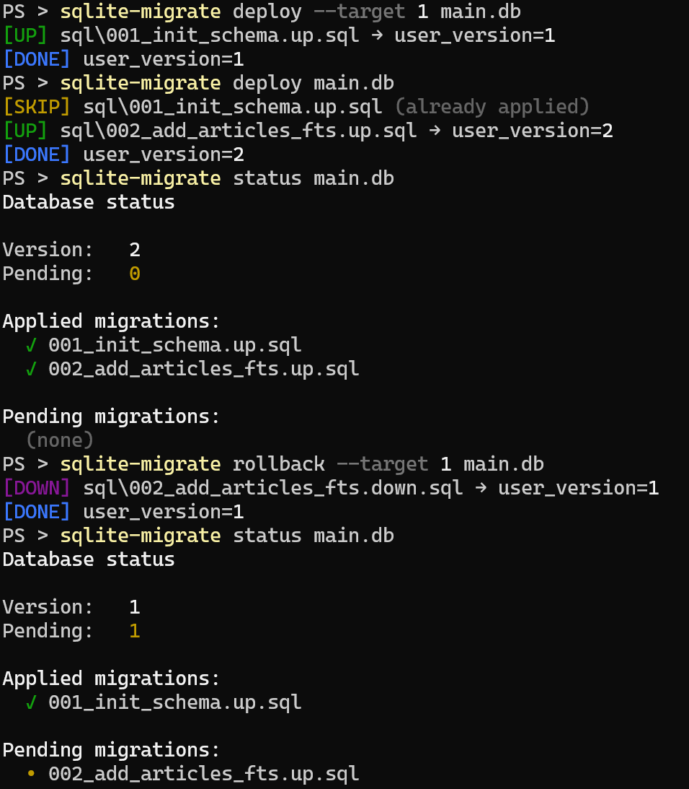

# sqlite-migrate

A lightweight, cross-platform SQLite migration tool that tracks applied
migrations using SQLite's built-in `user_version` pragma, without creating
a migration-history table.



## Usage

`sqlite-migrate` can be used in two ways:

- **As a CLI** -- manage migrations from a terminal, shell script or CI/CD pipeline.
- **As a Go library** -- run migrations directly from your application.

### CLI

Install the CLI:

```bash
go install github.com/antoniskalou/migrate/cmd/sqlite-migrate@latest
```

Check the available commands:

```bash
sqlite-migrate --help
```

### Go library

Install the library:

```bash
go get github.com/antoniskalou/migrate
```

Example:

```go
import (
  "fmt"
  "log"

  "github.com/antoniskalou/migrate"
)

func main() {
  db := connectToSQLite(...) // *sql.DB

  migrator := migrate.Migrator{
    // defaults to ./sql
    RootDir: "./my-migration-dir",
    // optional event handler
    OnEvent: func(event migrate.Event) {
      fmt.Println("received event:", event)
    },
  }

  currentVersion, err := migrator.Version(db)
  if err != nil {
    log.Fatal(err)
  }
  fmt.Println("current version:", currentVersion)

  target := 2
  version, err := migrator.Deploy(db, &target)
  if err != nil {
    log.Fatal(err)
  }
  fmt.Println("Deployed to version:", version)
}
```

See the [Go API documentation][1] for API details and examples.

## How it works

SQLite provides a built-in integer setting called `user_version`, accessible
through `PRAGMA user_version`. It is intended for application use and does not
create a separate table. See the [SQLite documentation][2].

`sqlite-migrate` uses this value to track the current migration version.

Migrations are stored in a directory configured by the user, defaulting to `./sql`.
Each migration consists of an `.up.sql` file and, optionally, a corresponding
`.down.sql` file for rollback.

For example:

```
sql/
├── 001_create_users.up.sql
├── 001_create_users.down.sql
├── 002_create_posts.up.sql
└── 002_create_posts.down.sql
```

Migrations are executed in alphabetical order. After each migration,
`user_version` is updated to reflect the current version.

Deploy all pending migrations:

```bash
$ sqlite-migrate deploy main.db
[UP] sql/001_create_users.up.sql → user_version=1
[UP] sql/002_create_posts.up.sql → user_version=2
[DONE] user_version=2
```

Check the migration status:

```bash
$ sqlite-migrate status main.db
Database status

Version:   2
Pending:   0

Applied migrations:
  ✓ 001_create_users.up.sql
  ✓ 002_create_posts.up.sql

Pending migrations:
  (none)
```

Running `deploy` again skips migrations that have already been applied:

```bash
$ sqlite-migrate deploy main.db
[SKIP] sql\001_create_users.up.sql (already applied)
[SKIP] sql\00s_create_posts.up.sql (already applied)
[DONE] user_version=2
```

### Limitations

The tool does not record which migration filenames have been applied. It relies on
`user_version` and the ordering of files in the migration directory.

Consequently, **changing migration filenames, removing existing migrations, or changing
their order after they have been applied can lead to incorrect or unexpected behaviour.**

Keep applied migration files unchanged and preserve their ordering. The current
implementation does not detect or automatically resolve changes to migration history.

## Contributing

Building the project:

```bash
go build ./...
```

Running the tests:

```bash
go test ./...
```

Static analysis:

```bash
go vet ./... && staticcheck ./...
```

## License

See [LICENSE](LICENSE).

[1]: https://pkg.go.dev/github.com/antoniskalou/migrate
[2]: https://sqlite.org/pragma.html#pragma_user_version
